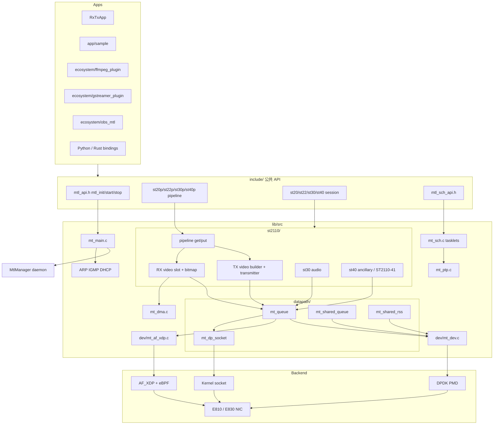
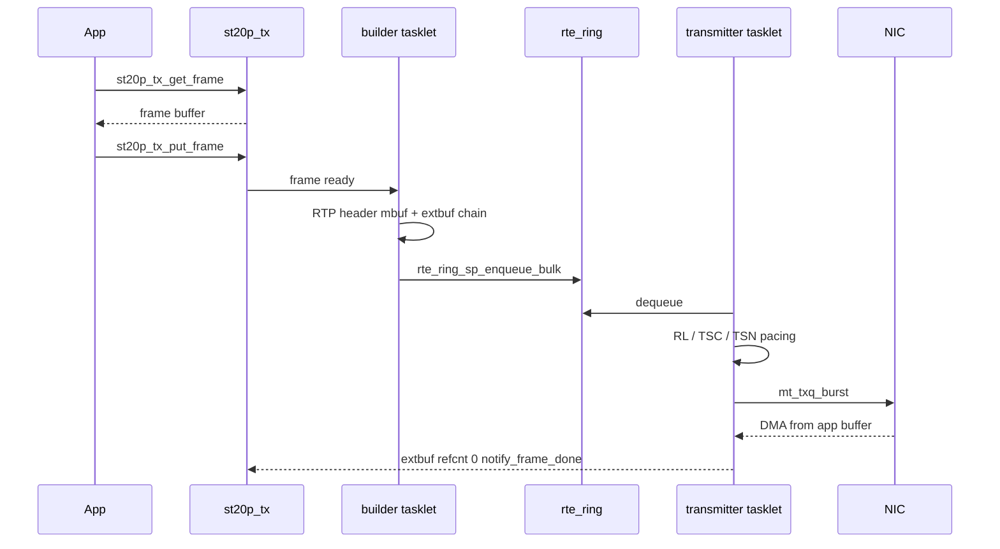
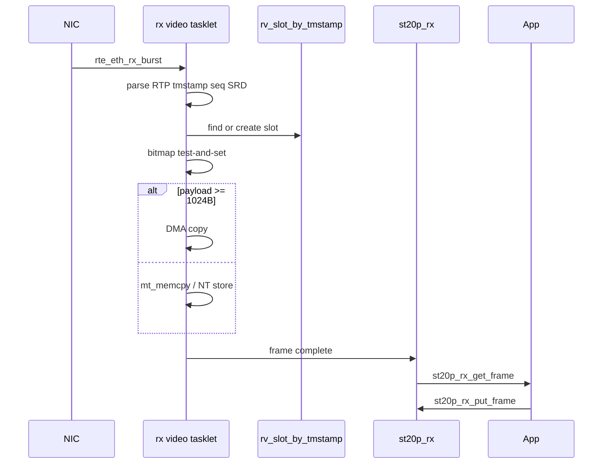

# Media Transport Library 架构设计

## 概述

Media Transport Library（MTL）是 Intel Open Visual Cloud 的软件媒体传输栈，面向托管 IP 网上的专业媒体（SMPTE ST 2110）。它把帧级视频/音频/辅助数据封装为 RTP/UDP/IP，并按 ST 2110-21 做流量整形。

目标用户是广播、云端/边缘媒体网关、FFmpeg/GStreamer/OBS 插件开发者。典型效果：在 Intel E810/E830 等带限速能力的网卡上，单核可发送约 16 路 1080p YUV422 10-bit 59.94 fps（约 50 Gbps）的 uncompressed 视频，同时满足 narrow/wide pacing。

核心架构特征：

- 控制面与数据面分离。数据面禁止阻塞、禁止 `malloc`/`pthread_mutex`。
- 虚拟数据路径后端：DPDK PMD、内核 socket、AF_XDP。
- 协作式 tasklet 调度，默认绑核 busy poll。
- 三层 API：Pipeline（get/put）包装 Session（回调）包装 Transport（内部发包）。

## 技术栈

**语言与运行时**

- 库核心：C99（原子操作用 C11 `<stdatomic.h>`）
- 测试：C++ gtest、Python pytest
- 绑定：Python（SWIG）、Rust（`imtl` crate）
- Manager：C++ 守护进程

**构建**

- Meson + Ninja（`meson.build`、`build.sh`）
- 依赖版本钉在 `versions.env`：DPDK 26.07、ICE 2.6.7、IAVF 4.13.35、FFmpeg 7.0、xdp-tools 1.6.3、libbpf 1.7.0

**数据平面依赖**

- DPDK `>= 25.03`（`lib/meson.build`）
- json-c、libnuma、pthread、libm
- 可选：libxdp + libbpf（AF_XDP）、Level Zero（GPU Direct）、SystemTap SDT（USDT）

**基础设施**

- Hugepage（推荐 2MB）
- SR-IOV VF / VFIO
- MtlManager 守护进程做 lcore、eBPF、flow 仲裁
- GitHub Actions CI、Coverity、Trivy

## 项目结构

```text
Media-Transport-Library/
├── include/                 # 全部公共 API
├── lib/src/                 # 库核心
│   ├── mt_*.c               # 非媒体：调度、PTP、DMA、IGMP、统计
│   ├── datapath/            # 队列抽象、共享队列、RSS、kernel socket
│   ├── dev/                 # DPDK PMD、AF_XDP
│   └── st2110/              # ST2110 会话 + SIMD 转换 + pipeline
├── app/                     # 示例与工具（独立 meson 工程）
├── manager/                 # MtlManager 守护进程
├── plugins/                 # ST22 编解码等动态插件
├── ecosystem/               # FFmpeg / GStreamer / OBS / MXL
├── python/  rust/           # 语言绑定
├── gpu_direct/              # Level Zero GPU 内存封装
├── tests/                   # unit / integration / acceptance / fuzz
├── patches/                 # DPDK、ICE 等补丁
└── doc/                     # 设计与运行文档
```

**入口点**

- 库生命周期：`mtl_init` / `mtl_start` / `mtl_stop` / `mtl_uninit`（`include/mtl_api.h`，实现 `lib/src/mt_main.c`）
- 调度：`lib/src/mt_sch.c`，上限 `MT_MAX_SCH_NUM = 18`
- 设备：`lib/src/dev/mt_dev.c`
- 视频 TX/RX：`st_tx_video_session.c`、`st_rx_video_session.c`

## 控制面与数据面

MTL 把工作分成两个世界：

| | 控制面 | 数据面 |
|---|---|---|
| 职责 | 会话创建/销毁、配置、统计、ARP/DHCP | 组包、pacing、收包重组、DMA |
| 内存 | libc heap、mutex | Hugepage、`rte_spinlock_t`、无锁 ring |
| 约束 | 允许阻塞 | 禁止 `malloc`、mutex、sleep、INFO 日志 |

数据面调用控制面是破坏 pacing 的最常见原因。

## 子系统

### 1. 实例与设备层

**目的**：初始化 DPDK EAL、绑定端口、分配队列与 mempool。

**位置**：`lib/src/mt_main.c`、`lib/src/dev/`

**关键类型**：`mtl_handle`（`struct mtl_main_impl*`）、`struct mtl_init_params`

**能力**：每进程最多 8 个 NIC（`MTL_PORT_P` … `MTL_PORT_7`）。会话级冗余端口为 `MTL_SESSION_PORT_P/R`。

端口名决定后端：

| `pmd` | 端口名示例 | 说明 |
|-------|------------|------|
| `MTL_PMD_DPDK_USER` | `0000:af:01.0` | 生产路径，kernel bypass |
| `MTL_PMD_NATIVE_AF_XDP` | `native_af_xdp:enp175s0f0` | AF_XDP + eBPF |
| `MTL_PMD_KERNEL_SOCKET` | `kernel:enp175s0f0` | 实验性，走内核协议栈 |
| `MTL_PMD_DPDK_AF_XDP` / `MTL_PMD_DPDK_AF_PACKET` | 实验性 | DPDK 封装的内核路径 |

### 2. 虚拟数据路径与队列管理

**目的**：向上层提供统一的 `mt_txq_burst` / RX burst。

**位置**：`lib/src/datapath/`

- `mt_queue.c`：dedicated TX/RX 队列
- `mt_shared_queue.c`：`MTL_FLAG_SHARED_TX_QUEUE` / `MTL_FLAG_SHARED_RX_QUEUE`
- `mt_shared_rss.c`：无 Flow Director 时的 RSS 分发
- `mt_dp_socket.c`：内核 socket 后端

RX 分流优先级：Flow Director（每会话独立队列）> 共享队列 + 软件分发 > RSS。

### 3. Tasklet 调度器

**目的**：在绑核 busy-poll 线程上协作调度所有会话作业。

**位置**：`lib/src/mt_sch.c`，公共 API `include/mtl_sch_api.h`

一个 scheduler 反复调用已注册 tasklet。返回值：

- `MTL_TASKLET_HAS_PENDING`（1）：还有活
- `MTL_TASKLET_ALL_DONE`（0）：空闲

Tasklet 禁止阻塞。一个阻塞会饿死同核上所有会话。

两种运行模式：

- Lcore（默认）：`rte_eal_remote_launch` 绑核
- Pthread：`MTL_FLAG_TASKLET_THREAD`，适合容器

配额按 1080p 当量分配。不够则新建 scheduler，最多 18 个。`MTL_FLAG_TX_VIDEO_MIGRATE` / `MTL_FLAG_RX_VIDEO_MIGRATE` 允许运行时把过载会话迁到空闲核。

### 4. ST2110 传输层

**目的**：帧 <-> RTP 包，含 pacing 与重组。

**位置**：`lib/src/st2110/`

视频 TX 拆成两个 tasklet，用 `rte_ring` 连接：

1. Builder（`tvs_tasklet_handler`）：组 RTP 头，payload 用 extbuf 零拷贝指向帧
2. Transmitter（`video_trs_tasklet_handler`）：按 pacing 从 ring 取包，`mt_txq_burst` 送 NIC

音频/辅助数据每帧仅 1–8 包，单 tasklet、按帧 pacing。

RX 视频：按 RTP timestamp 找 slot，用 bitmap 去重，memcpy 或 DMA 写入预分配帧缓冲。`recv_size >= frame_size && dma_nb == 0` 时交付应用。

### 5. Pipeline 层

**目的**：对应用暴露 get/put 帧接口，内置帧生命周期与 SIMD 色彩转换。

**位置**：`lib/src/st2110/pipeline/`

`st20p_tx_create()` 内部调用 `st20_tx_create()`。帧状态用 C11 atomic 做无锁状态机，约定每个会话每个方向只有一个应用线程调用 get/put。

### 6. 控制协议（CNI）

DPDK PMD 完全绕过内核，因此库内实现：

| 协议 | 文件 | 作用 |
|------|------|------|
| ARP | `mt_arp.c` | 解析下一跳 MAC |
| IGMPv3 | `mt_mcast.c` | 组播加入 |
| DHCP | `mt_dhcp.c` | `MTL_PROTO_DHCP` |
| PTP | `mt_ptp.c` | 内置 IEEE 1588 客户端，硬件 timesync 约 30 ns |
| RTCP | `mt_rtcp.c` | 可选重传，非 ST 2110 标准 |

CNI 可跑在独立线程（`MTL_FLAG_CNI_THREAD`）或 tasklet。

### 7. MtlManager

**目的**：多进程资源仲裁。

**位置**：`manager/`

以 root 运行，负责：

- 给各 MTL 实例分配互不冲突的 lcore
- 加载 AF_XDP 的 eBPF/XDP 程序
- 配置 NIC flow/queue
- 监控实例退出并回收资源

备选方案是共享内存 lcore 分配（`doc/shm_lcore.md`），官方建议用 Manager。

## 系统架构图



## TX 数据路径



## RX 数据路径



## 内存模型

- 帧、mbuf、mempool、ring 走 DPDK hugepage，按 NIC NUMA socket 分配（`mt_socket_id`）。
- TX 视频：每会话独立 mempool，隔离泄漏。
- RX：每队列 mempool，多会话共享队列。
- 默认 mempool ops 为 stack（LIFO），提高 cache 复用。
- 零拷贝 TX：header mbuf + `rte_pktmbuf_attach_extbuf` 指向应用帧；NIC scatter-gather DMA。跨 hugepage 边界时回退 memcpy。
- 应用可通过 `mtl_hp_malloc` / `mtl_hp_zmalloc` / `mtl_hp_free` / `mtl_hp_virt2iova` 申请 hugepage。

## 线程清单

| 线程 | 作用 |
|------|------|
| Scheduler x 最多 18 | Tasklet 轮询 |
| TSC Calibration x 1 | 测量 TSC 频率 |
| Admin x 1 | watchdog、会话迁移 |
| Statistics x 1 | 周期 dump |
| CNI x 1 | ARP/PTP/DHCP/IGMP |
| Socket TX/RX | 仅 kernel 后端 |
| Shared RSS x 1 | 无 Flow Director 时 |

## 设计取舍

| 决策 | 原因 |
|------|------|
| DPDK 而非纯内核栈 | 100 Gbps 下微秒级 pacing |
| Tasklet 而非每会话线程 | LLC 局部性、核密度 |
| extbuf 零拷贝 | 4K60 memcpy 约 1.2 GB/s，16 路会打满 NUMA 带宽 |
| builder 与 transmitter 分离 | 组包与 pacing 时间尺度不同 |
| 硬件 RL 优先于 TSC | 亚微秒精度、CPU 开销接近 0 |
| 冗余优先于重传 | ST 2022-7 双路径；RTCP 仅为可选、非标准 |
