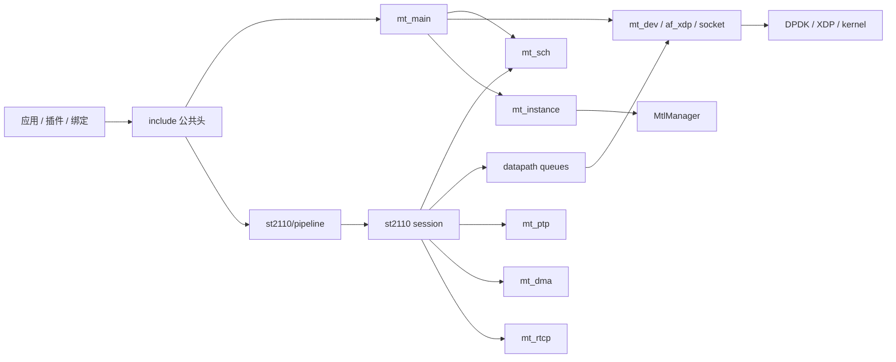

# Media Transport Library 模块映射

## 公共头文件（`include/`）

| 头文件 | 职责 |
|--------|------|
| `mtl_api.h` | 实例生命周期、端口、PMD、init flag、hugepage、DMA、统计、日志 |
| `mtl_sch_api.h` | 应用侧 scheduler / tasklet |
| `mtl_lcore_shm_api.h` | 废弃的共享内存 lcore 分配 |
| `st_api.h` | 公共媒体类型：FPS、时间戳格式、帧状态、timing parser 判定 |
| `st20_api.h` | ST 2110-20/22 session 创建、回调、slice、RTP |
| `st30_api.h` | ST 2110-30 session |
| `st40_api.h` | ST 2110-40 session，含 Fast Metadata 标志 |
| `st_pipeline_api.h` | st20p / st22p、插件注册（encoder/decoder/converter） |
| `st30_pipeline_api.h` | st30p get/put |
| `st40_pipeline_api.h` | st40p get/put |
| `st_convert_api.h` | SIMD 色彩转换公开 API |
| `st_convert_internal.h` | 转换内部表 |
| `experimental/st20_combined_api.h` | 实验性组合 API |

命名前缀约定：

- `mt_` 库内部非媒体
- `mtl_` 公共核心 API
- `st20_` / `st22_` / `st30_` / `st40_` session
- `st20p_` / `st22p_` / `st30p_` / `st40p_` pipeline
- `tv_` / `rv_` 视频 TX/RX 内部

## 库核心（`lib/src/`）

### 非媒体

| 文件 | 职责 |
|------|------|
| `mt_main.c` / `mt_main.h` | 实例、`mtl_init` 实现、全局常量（`MT_MAX_SCH_NUM` 等） |
| `mt_sch.c` | Tasklet 调度、配额、迁移、sleep |
| `mt_admin.c` | Watchdog、过载迁移 |
| `mt_config.c` | JSON 配置（`kahawai.json`） |
| `mt_ptp.c` | 内置 PTP、PHC |
| `mt_dma.c` | RX DMA 拷贝引擎 |
| `mt_flow.c` | Flow Director 规则 |
| `mt_mcast.c` | IGMPv3 |
| `mt_arp.c` | ARP |
| `mt_dhcp.c` | DHCP |
| `mt_rtcp.c` | NACK / 重传 |
| `mt_stat.c` | 统计线程 |
| `mt_cni.c` | 控制报文分发 |
| `mt_socket.c` | 辅助 socket |
| `mt_instance.c` | 与 MtlManager IPC |
| `mt_pcap.c` | 抓包 |
| `mt_tap.c` | Windows TAP |
| `mt_log.c` | 日志 |
| `mt_util.c` | memcpy 封装、mempool 尺寸 |
| `mt_usdt.h` / `mt_usdt_provider.d` | USDT 探针 |

### 设备与数据路径

| 路径 | 职责 |
|------|------|
| `dev/mt_dev.c` | DPDK 口配置、descriptor、TX reclaim |
| `dev/mt_af_xdp.c` | Native AF_XDP |
| `datapath/mt_queue.c` | Dedicated 队列 |
| `datapath/mt_shared_queue.c` | 共享 TX/RX 队列 |
| `datapath/mt_shared_rss.c` | Shared RSS |
| `datapath/mt_dp_socket.c` | Kernel socket 后端 |

### ST 2110

| 路径 | 职责 |
|------|------|
| `st_tx_video_session.c` | 视频 TX builder、零拷贝、pacing 训练 |
| `st_video_transmitter.c` | 视频 TX transmitter |
| `st_rx_video_session.c` | 视频 RX slot、bitmap、DMA |
| `st_rx_timing_parser.c` | ST 2110-21 RX 合规解析 |
| `st_tx_audio_session.c` / `st_audio_transmitter.c` | 音频 TX |
| `st_rx_audio_session.c` | 音频 RX |
| `st_tx_ancillary_session.c` / `st_ancillary_transmitter.c` | 辅助数据 TX |
| `st_rx_ancillary_session.c` | 辅助数据 RX |
| `st_avx2.c` / `st_avx512.c` / `st_avx512_vbmi.c` | SIMD CSC |
| `st_convert.c` / `st_fmt.c` | 格式与转换调度 |
| `pipeline/st20_pipeline_*.c` 等 | get/put、帧状态机 |
| `pipeline/st_plugin.c` | 动态插件加载 |

Windows 兼容层在 `lib/windows/`。

## 应用与生态

| 目录 | 内容 |
|------|------|
| `app/sample/` | Pipeline / legacy / slice / RTP / fwd / GPU Direct 样例 |
| `app/tools/` | convert_app、lcore_shmem_mgr |
| `app/perf/` | 性能相关程序 |
| `app/v4l2_to_ip/` | V4L2 采集到 ST 2110 |
| `tests/tools/RxTxApp` | JSON 驱动的收发应用，验收测试入口 |
| `manager/` | `MtlManager`：lcore、XDP、flow |
| `plugins/st22_avcodec/` | libavcodec 的 ST22 插件 |
| `plugins/sample/` | 插件模板 |
| `ecosystem/ffmpeg_plugin/` | FFmpeg 4.4 / 6.1 / 7.0 |
| `ecosystem/gstreamer_plugin/` | GStreamer st20p/st30p/st40p |
| `ecosystem/obs_mtl/` | OBS |
| `ecosystem/MTL_with_MXL/` | MXL 桥 |
| `python/` | SWIG 绑定与示例 |
| `rust/` | `imtl` + `imtl-sys` |
| `gpu_direct/` | Level Zero 封装 |
| `tools/ebpf/` | eBPF 辅助 |
| `tools/set_tai_offset/` | UTC/TAI 37 秒偏移 |
| `config/` | RxTxApp JSON 场景（1v1a1anc、冗余等） |

## 构建与运行入口

```text
./build.sh                  # 顺序：lib -> app -> tests -> plugins -> manager -> RxTxApp
./build.sh debug            # debug + ASan
./build.sh unit             # 无 NIC 单测
./format-coding.sh          # clang-format-14 / black / shfmt
./checkpatch.sh             # pre-commit 全语言检查
```

运行 ST 2110 演示见 `doc/run.md`。VF 创建：`script/nicctl.sh create_vf`。硬件 RL 需要补丁 ICE 驱动：`script/build_drivers.sh`。

## 关键生命周期 API

实例：

```text
mtl_init -> (st*p_*_create 可在 start 前后) -> mtl_start -> mtl_stop -> st*p_*_free -> mtl_uninit
```

Pipeline 热路径：

```text
st20p_tx_create
loop:
  st20p_tx_get_frame
  fill
  st20p_tx_put_frame
st20p_tx_free
```

Scheduler（应用自定义作业）：

```text
mtl_sch_create -> mtl_sch_register_tasklet -> mtl_sch_start
mtl_sch_stop -> mtl_sch_unregister_tasklet -> mtl_sch_free
```

## 依赖关系（模块级）


