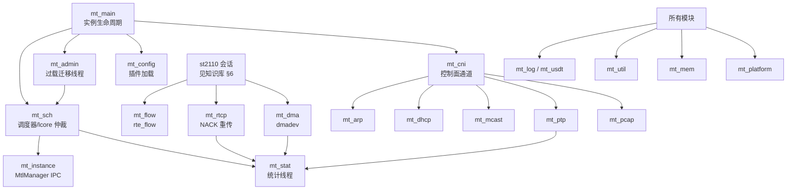

# `lib/src/` 根目录源码分析

分析对象：`lib/src/` **根目录**下的全部源文件（共 44 个，约 1.7 万行）。
子目录 `dev/`（DPDK PMD / AF_XDP）、`datapath/`（队列后端）、`st2110/`（媒体会话）**不在本组文档范围**，架构级描述见 `../ARCHITECTURE.md` 与 `.github/copilot-docs/mtl-knowledge-base.md`。

这些文件对应 AGENTS.md 中的"`lib/src/mt_*.c` — core, non-media"：实例生命周期、调度器、PTP、DMA、网络服务（ARP/DHCP/IGMP/RTCP）、统计、日志、跨平台与工具层。

## 文档组织

| 文档 | 范围 |
|------|------|
| [core.md](core.md) | 实例与调度：`mt_main` / `mt_sch` / `mt_admin` / `mt_config` / `mt_instance` |
| [network.md](network.md) | 网络服务：`mt_cni` / `mt_arp` / `mt_dhcp` / `mt_mcast` / `mt_flow` / `mt_socket` / `mt_tap` / `mt_pcap` |
| [services.md](services.md) | 时间与支撑服务：`mt_ptp` / `mt_rtcp` / `mt_dma` / `mt_stat` / `mt_log` / `mt_util` / `mt_usdt` |
| [headers.md](headers.md) | 纯头文件与构建：`mt_header.h` / `mt_mem.h` / `mt_platform.h` / `mt_quirk.h` / `mt_simd.h` / `mt_handle_guard.h` / `meson.build` |

## 文件速查表

行数截至 `feat/rk3588-apps` 分支（版本 26.09.0.DEV）。

| 文件 | 行数 | 一句话职责 | 详见 |
|------|------|-----------|------|
| `mt_main.c` | 1385 | `mtl_init/uninit/start/stop/abort` 实例生命周期实现 + 十余个公开 API（lcore 借用、外部内存 DMA map、udma、PTP 读时、info 查询等） | [core.md](core.md#mt_mainc--mt_mainh) |
| `mt_main.h` | 2032 | 中心头：主体 `struct mtl_main_impl` 聚合全部子系统状态；`MT_MAX_SCH_NUM=18` 等全局常量；`mt_*` inline 访问器 | [core.md](core.md#mt_mainc--mt_mainh) |
| `mt_sch.c` | 1436 | Tasklet 调度器：≤18 个 scheduler、lcore 仲裁（共享内存+文件锁+manager）、1080p 配额、sleep 节能 | [core.md](core.md#mt_schc--mt_schh) |
| `mt_sch.h` | 84 | 调度器 inline 访问器（instance/active/started/busy 判定） | [core.md](core.md#mt_schc--mt_schh) |
| `mt_admin.c` | 407 | 后台 admin 线程（6s 周期）：CPU busy 计算 + 过载时视频会话跨 scheduler 迁移 | [core.md](core.md#mt_adminc--mt_adminh) |
| `mt_admin.h` | 13 | `mt_admin_init/uinit` 声明 | [core.md](core.md#mt_adminc--mt_adminh) |
| `mt_config.c` | 68 | 解析 `kahawai.json`（或 `$KAHAWAI_CFG_PATH`），当前仅加载 plugins 数组 → `st_plugin_register` | [core.md](core.md#mt_configc--mt_configh) |
| `mt_config.h` | 13 | `mt_config_init/uinit` 声明 | [core.md](core.md#mt_configc--mt_configh) |
| `mt_instance.c` | 345 | 与 `MtlManager` 守护进程的 AF_UNIX IPC 客户端：lcore/queue/flow/xsks-fd/udp-filter 仲裁 | [core.md](core.md#mt_instancec--mt_instanceh) |
| `mt_instance.h` | 26 | 上述 IPC 接口声明 | [core.md](core.md#mt_instancec--mt_instanceh) |
| `mt_cni.c` | 765 | CNI 控制面通道：媒体端口上非媒体报文的分类分发（ARP/DHCP/IGMP/PTP→对应模块，其余→内核）、CSQ 共享队列、pcap dump | [network.md](network.md#mt_cnic--mt_cnih) |
| `mt_cni.h` | 30 | `mt_cni_*` 与 `mt_csq_*`（cni 共享接收队列）接口 | [network.md](network.md#mt_cnic--mt_cnih) |
| `mt_arp.c` | 379 | 用户态 ARP：请求/缓存表（60 条）/应答解析，供 TX 目的 MAC 解析 | [network.md](network.md#mt_arpc--mt_arph) |
| `mt_dhcp.c` | 589 | 极简 DHCP 客户端（DISCOVER/REQUEST/RENEW），ip/netmask/gateway 获取 | [network.md](network.md#mt_dhcpc--mt_dhcph) |
| `mt_mcast.c` | 805 | IGMPv3 客户端：join/leave（SSM）、query 应答、周期刷新、端口 reset 后恢复、L2 组播 | [network.md](network.md#mt_mcastc--mt_mcasth) |
| `mt_flow.c` | 357 | NIC 硬件流规则（rte_flow）：dip/dport/raw 模式匹配引流到指定 RX 队列 | [network.md](network.md#mt_flowc--mt_flowh) |
| `mt_socket.c` | 550 | 内核侧辅助 socket：接口 IP/MAC/gw/NUMA 读写、SO_ATTACH_FILTER 端口过滤、组播加入 | [network.md](network.md#mt_socketc--mt_socketh) |
| `mt_tap.c` | 936 | Windows 专属（`MTL_HAS_TAP`）：TAP-Windows6/Wintun 虚拟网卡桥接控制报文到系统协议栈 | [network.md](network.md#mt_tapc--mt_taph) |
| `mt_pcap.c` | 104 | `rte_pcapng` 封装：把 mbuf 批量写入 pcapng 文件（依赖带用户时间戳补丁的 DPDK） | [network.md](network.md#mt_pcapc--mt_pcaph) |
| `mt_ptp.c` | 1680 | 内置 IEEE 1588 PTP 客户端：Sync/Follow_Up/Announce/Delay 全报文处理 + 伺服（step/slew）调系统时钟 | [services.md](services.md#mt_ptpc--mt_ptph) |
| `mt_rtcp.c` | 614 | 自定义 RTCP NACK 重传：TX 端 RTP 缓存+重传，RX 端 seq bitmap 丢包检测+NACK 发送 | [services.md](services.md#mt_rtcpc--mt_rtcph) |
| `mt_dma.c` | 630 | DPDK dmadev（idxd/IOAT）管理：lender 共享模型、copy/fill/submit、异步 mbuf 清理、IOVA 映射表 | [services.md](services.md#mt_dmac--mt_dmah) |
| `mt_stat.c` | 195 | 统计线程：注册回调表，默认 10s 周期集中打印各模块 stat | [services.md](services.md#mt_statc--mt_stath) |
| `mt_log.c` | 132 | 日志设施：全局 level、可替换前缀 formatter / printer、文件流、USDT log 转发 | [services.md](services.md#mt_logc--mt_logh) |
| `mt_util.c` | 1154 | 库内工具箱：bitmap、u64 环、mempool 封装、pacing 训练结果缓存、dump、CPU 采样、软件 RSS 等 | [services.md](services.md#mt_utilc--mt_utilh) |
| `mt_usdt.h` | 280 | USDT 静态探针宏（`MT_DTRACE_PROBEn`），未启用时全部 no-op | [services.md](services.md#mt_usdth--mt_usdt_providerd) |
| `mt_usdt_provider.d` | 151 | dtrace provider 定义：sys/ptp/st20/st22/st30/st40/st20p/st22p/st30p/st40p 全部探针 | [services.md](services.md#mt_usdth--mt_usdt_providerd) |
| `mt_header.h` | 67 | 内部公共定义：`mt_handle_type`、`mt_udp_hdr`(42B)、`mt_stat_u64`、`mt_rx_pcap` | [headers.md](headers.md#mt_headerh) |
| `mt_mem.h` | 46 | 内存分配统一入口：libc 版与 `rte_malloc`+socket 版；ASAN 时切换为可检查实现 | [headers.md](headers.md#mt_memh) |
| `mt_platform.h` | 159 | Linux/Windows 抽象：pthread 包装（P_SHARED + monotonic cond）、时钟 ID、锁文件路径 | [headers.md](headers.md#mt_platformh) |
| `mt_quirk.h` | 24 | clang release 下 `rte_ring_sc_dequeue_bulk` 变长 n 的规避分支 | [headers.md](headers.md#mt_quirkh) |
| `mt_simd.h` | 44 | `MT_TARGET_CODE_START/STOP`：SSE4.2/AVX2/AVX512/VBMI 分节编译宏 | [headers.md](headers.md#mt_simdh) |
| `mt_handle_guard.h` | 159 | 公开句柄 use-after-free 防护：destroying+refcnt（SEQ_CST Dekker），ARM 弱内存序安全 | [headers.md](headers.md#mt_handle_guardh) |
| `meson.build` | 35 | lib 核心 18 个 `.c` 的源列表；Windows 条件加 `mt_tap.c` 与 `win_posix.c` | [headers.md](headers.md#mesonbuild) |

## 模块协作总览

## 与"两世界规则"的对应（AGENTS.md）

- **控制面**（可阻塞）：`mt_instance.c`（socket IPC）、`mt_config.c`（文件读取）、`mt_admin.c`/`mt_stat.c`（独立 pthread）、`mt_main.c` 的 init/uninit 路径。
- **数据面**（不得阻塞、不得 malloc）：`mt_sch.c` 的 tasklet 循环、`mt_cni.c` 的收包分发（也可作 tasklet）、`mt_ptp.c` 的 rxq tasklet、`mt_dma.c` 的 copy/submit 路径。
- `mt_log.h` 的 `dbg/info/warn/err` 宏与 `mt_usdt.h` 探针在热路径上的开销由编译期开关和 USDT attach 状态控制。
