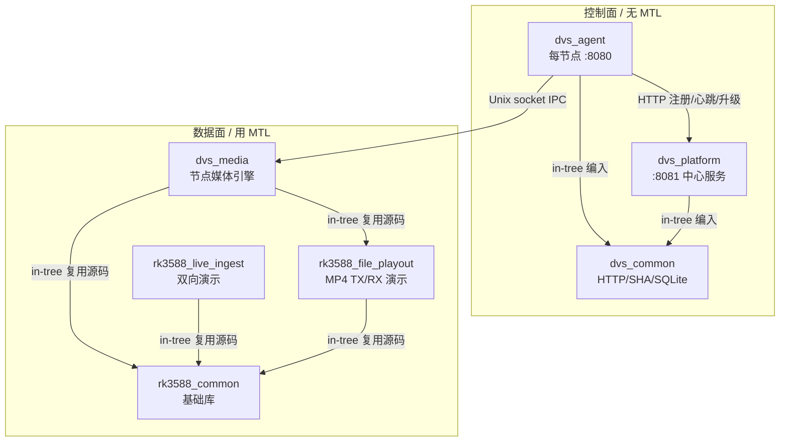

# RK3588 三个 app 与 DVS app 的关系及 MTL 使用分析

> 仓库：`kkkqkx123/Media-Transport-Library`（通过 gh-proxy.com 拉取，`--depth=1`）
> 分析范围：`app/` 目录下的 `rk3588_common`、`rk3588_live_ingest`、`rk3588_file_playout` 与 `dvs_*`（dvs_common / dvs_agent / dvs_media / dvs_platform）
> 约定：下文"**3 个 rk3588 app**"指 `rk3588_common`、`rk3588_live_ingest`、`rk3588_file_playout`；"**dvs app / DVS 媒体应用**"特指承担数据面、真正调用 MTL 的 `dvs_media`（其余 `dvs_common/agent/platform` 为控制面基础设施，文中一并说明）。

---

## 0. 结论速览

| 维度 | 结论 |
|---|---|
| 三者与 dvs 的关系 | `dvs_media` 由 `rk3588_file_playout` 的 **RX 侧演进而来**，并通过 meson **in-tree 编译**（不复制）复用 `rk3588_common` 与 `rk3588_file_playout` 的 `rx/`、`shared/`、`tx/mp4_demux` 源码。`rk3588_live_ingest` 是独立的双向演示管道，与 dvs 无直接代码复用关系。 |
| MTL 角色 | MTL 只服务于**数据面**：`rk3588_live_ingest`（TX+RX 双向）、`rk3588_file_playout`（TX+RX 双向）、`dvs_media`（仅 RX）。控制面 `dvs_agent/平台` 完全不接触 MTL。 |
| 抽象层次 | `rk3588_common` = 无状态基础组件库；`live_ingest` / `file_playout` = 端到端参考实现（demo）；`dvs_media` = 受控的生产级媒体引擎（替换 file_playout RX）。 |
| 复用方式 | `dvs_media/meson.build` 直接把 `rk3588_file_playout/*.c` 编进自己的静态库/可执行文件（in-tree，零拷贝、零分叉），保证算法单一来源。 |

---

## 1. 模块定位与依赖关系

### 1.1 三个 rk3588 app

| 模块 | 类型 | 职责 | 与 MTL 的关系 | 构建方式 |
|---|---|---|---|---|
| `rk3588_common` | 纯 C 静态库 | 跨应用复用的无状态基础组件：`ring_buffer`（无锁环形缓冲）、`slab_pool`（预分配内存池）、`timer`（单调定时）、`pipeline_common.h`（dmabuf_frame / codec_packet 等跨应用数据结构）、`codec_plugin.h`（编解码插件接口） | 可选依赖：找到 MTL 时 `-DHAVE_MTL=1` 编译，找不到也能独立构建（`rk3588_common/README.md:3`） | 作为 `rk3588_common_dep` 被引用 |
| `rk3588_live_ingest` | 独立 meson 工程（不入 `app/meson.build`） | HDMI 实时采集 → RGA 色彩转换 → MPP 硬编码（H.264）→ **MTL TX（ST2110-20/22）** → **MTL RX** → MPP 解码 → DRM 渲染，端到端低时延演示管道 | **双向**：既发（TX）又收（RX） | `cd app/rk3588_live_ingest && meson setup build && ninja`（`rk3588_live_ingest/README.md:3`） |
| `rk3588_file_playout` | 独立 meson 工程（TX/RX 可分离） | MP4（H.264+AAC）经 **MTL ST2110-22（视频）/ ST2110-30（音频）** 实时收发；RX 侧 MPP 硬解 + DRM 显示 + ALSA 出声 | **双向**：TX 发流、RX 收流 | `meson setup build -Dbuild_tx=true -Dbuild_rx=true`（`rk3588_file_playout/README.md:79`） |

### 1.2 dvs 套件四个目录

| 模块 | 类型 | 职责 | 是否用 MTL |
|---|---|---|---|
| `dvs_common` | C++17 源文件集合（HTTP server/client、SHA-256、内置 SQLite） | 控制面共享基础设施，被 `dvs_agent` 与 `dvs_platform` in-tree 编入各自二进制 | 否 |
| `dvs_agent` | C++17 可执行文件 | 运行在每个 RK3588 节点上的**节点代理**：注册/心跳、经 IPC 驱动本机 `dvs_media`、维护、本地 HTTP API + Web 前端 | 否 |
| `dvs_media` | 纯 C 可执行文件 | **节点媒体引擎**：接收 MTL ST2110 流，解码合成后 DRM 显示 + ALSA 出声；受控运行（IPC 驱动 configure/prepare/commit） | **是（仅 RX）** |
| `dvs_platform` | C++17 可执行文件 | 平台侧控制服务：节点注册/心跳网关、分组/墙/场景/绑定文档、布局像素拆分、跨节点两阶段提交屏障、批量升级 | 否 |

### 1.3 依赖与复用拓扑



关键事实（`dvs_media/meson.build:14-94`）：

- 复用 `rk3588_common/src/{ring_buffer,slab_pool,timer}.c`（`-DHAVE_MTL=1`）。
- 复用 `rk3588_file_playout/shared/*`（au_trace、drm_mode、display_layout、ptp_time、tx_tai_ts、e2e_stamp、rx_e2e_stats）。
- 复用 `rk3588_file_playout/rx/*`（alsa_audio、playout_buffer、av_sync、media_clk、**mtl_rx_mp4、mtl_rx_bridge、mtl_rx_audio**、mpp_decoder、drm_renderer、h264_prep、rx_pipeline、rx_compositor）以及 `tx/mp4_demux.c`、`tx/extradata_handler.c`。
- 自身仅新增控制/引擎层：`engine/`（engine_ctx、session_mgr、session_admit、layout_executor、audio_arbiter、capability、ipc_engine_bridge）、`ipc/`（ipc_server、state_machine）、`dvs_media_main.c`。

> 即：`dvs_media = file_playout RX 管线 + 受控引擎外壳 + IPC 控制面`。这正是 `dvs_media/README.md:5` 所述"由 `rk3588_file_playout` 的 RX 侧演进而来"。

---

## 2. 三者如何使用 MTL

所有 MTL 调用都收敛到 `st_api.h` / `mtl_api.h` 的 ST22/ST30 会话 API。三者的使用形态对比：

| 形态 | `rk3588_live_ingest` | `rk3588_file_playout` | `dvs_media` |
|---|---|---|---|
| 方向 | TX + RX 双向 | TX + RX 双向 | **仅 RX** |
| 视频 | `st22_tx_create` / `st22_rx_create`（ST22 帧级 codestream，YUV420-8bit，PT=112） | `st22_tx_create`（视频）/ `st22_rx_create`（mtl_rx_mp4.c） | 复用 file_playout 的 `mtl_rx_mp4.c`（`st22_rx_create`） |
| 音频 | 未涉及（live_ingest 仅视频） | `st30_tx_create` / `st30_rx_create`（mtl_tx_audio.c / mtl_rx_audio.c，ST2110-30 PCM） | 复用 file_playout 的 `mtl_rx_audio.c`（`st30_rx_create`） |
| 时钟 | PTP（内置或外部） | 外部 PTP → `CLOCK_TAI`，`ptp_get_time_fn`；USER_TIMESTAMP + TAI 时间轴 | 复用 `ptp_time.c`，引擎用 `mtl_ptp_read_time` 锚定（`engine_ctx.c:176`、`ipc_engine_bridge.c:38`） |
| 帧缓冲 | app 侧 `fb_addr[i] = st22_tx_get_fb_addr(...)`，生产者/消费者环形状态机（`mtl_tx.c:118-123`） | 由 `file_playout_mtl_init` 统一创建会话 | 由 `file_playout_mtl_init` 统一创建会话（`engine_ctx.c:106-121`） |
| 背压 | RX 描述符池 + ring，池耗尽 drop 并告警（`mtl_rx.c:70-104`） | RX 描述符池 + ring（`mtl_rx_mp4.c:30-94`） | 同 file_playout RX |

### 2.1 `rk3588_live_ingest` 的 MTL 用法（最完整的双向示例）

**TX（`mtl_tx.c:87-119`）**：构造 `struct st22_tx_ops`，设为 `ST22_TYPE_FRAME_LEVEL`、`ST22_PACK_CODESTREAM`、`ST20_FMT_YUV_420_8BIT`、`ops.payload_type = 112`、关闭 boxes（`ST22_TX_FLAG_DISABLE_BOXES`）；注册 `get_next_frame` / `notify_frame_done` 回调；`framebuff_cnt` 帧缓冲由 `st22_tx_get_fb_addr` 取回，应用把编码码流直接写入帧缓冲后 `publish_fb`。这是**帧级零拷贝直写**模式。

**RX（`mtl_rx.c:118-145`）**：构造 `st22_rx_ops`，`notify_frame_ready` 回调里把帧塞进 `ring_buffer`（非阻塞），下游（桥接/解码）从 ring 取帧；池满则 `st22_rx_put_framebuff` 归还并计数 drop，实现**数据面背压**。

### 2.2 `rk3588_file_playout` 的 MTL 用法

- **TX 视频**（`tx/mtl_tx_video.c`）：ST22 帧级 codestream，`USER_TIMESTAMP + TAI` 时间轴（`shared/tx_tai_ts.c`），CFR pacing。
- **TX 音频**（`tx/mtl_tx_audio.c`）：ST30 PCM 收发。
- **RX**（`rx/mtl_rx_mp4.c:98-130`）：`st22_rx_create`，`notify_frame_ready` 中做 `ST_FRAME_STATUS_COMPLETE/RECONSTRUCTED` 校验，按 `meta->timestamp` 经 `media_clk_frame_pts` 锚定到 TAI（`mtl_rx_mp4.c:79-80`），再推 ring。
- **MTL 初始化**：`file_playout_mtl_init(...)` 统一创建 MTL 会话句柄 `struct mtl_session *st`，供 TX/RX 共享。

### 2.3 `dvs_media` 的 MTL 用法（受控 RX）

- 引擎**只在需要时才初始化 MTL**（`engine_ctx.c:106-121` 的 `dvs_engine_init_mtl`，以及 `apply_layout_at` 内 195-204 懒初始化）。
- 全部 RX 能力来自复用：`mtl_rx_mp4.c`、`mtl_rx_audio.c`、`mtl_rx_bridge.c`，会话创建逻辑与 file_playout 完全一致。
- 受控模式下引擎**空闲启动**（`--ipc-sock`），由 IPC 的 `configure/prepare/commit` 才真正 `apply_layout` 创建/调整 RX 会话（`dvs_media_main.c:71-86`、`engine_ctx.c:182-311`）。
- 时间同步通过 `mtl_ptp_read_time(st)` 注入合成器与音频同步（`engine_ctx.c:175-178`）。

```c
// engine_ctx.c:106-117  — dvs_media 的 MTL 初始化入口（与 file_playout 同源）
int dvs_engine_init_mtl(dvs_engine* e) {
    if (e->st == NULL) {
        e->st = file_playout_mtl_init(&e->cfg, e->cfg.rx_port, e->cfg.rx_lip, 0, 1,
                                  e->cfg.mtl_log_level, e->cfg.mtl_lcores_rx);
        ...
    }
}
```

---

## 3. 关键关系总结

1. **演进关系（代码血缘）**：`dvs_media` ⇒ `rk3588_file_playout`（RX 侧）；两者共享 `rk3588_common`。`rk3588_live_ingest` 是另一条独立双向链路，作为 HDMI→MTL→DRM 的完整参考实现，未参与 dvs 复用。
2. **职责分层**：`rk3588_common`（地基）→ `rk3588_*`（参考实现/demo）→ `dvs_media`（生产受控引擎）；`dvs_common/agent/platform`（控制面）与数据面正交，仅在每节点由 `dvs_agent` 通过 IPC 驱动 `dvs_media`。
3. **MTL 收敛**：三者的 MTL 使用高度同构（ST22/ST30 + PTP/TAI + 帧缓冲/ring + 背压），差异仅在"是否双向"和"是否受控"。`dvs_media` 把 file_playout 的 RX 直接复用，几乎没有 MTL 层的新代码，体现出"算法单一来源"的复用纪律。
4. **构建隔离**：所有 rk3588/dvs 数据面 app 都是**独立 meson 工程**，不接入顶层 `app/meson.build`，需各自 `meson setup && ninja`（便于在编译服务器上按依赖分阶段构建）。

---

## 4. 待核实/开放点

- `dvs_media` 与 `rk3588_file_playout` 的 RX 是**源码级 in-tree 复用**而非独立库链接，长期维护需关注两处同步（改 file_playout RX 会直接波及 dvs_media，反之亦然）。
- `dvs_media` 当前**只复用 RX**；若未来需要在节点侧做"文件源回放即 TX"，需像 file_playout 那样引入 `tx/*`（目前未引入，见 `dvs_media/meson.build` 仅编入 `tx/mp4_demux.c`、`tx/extradata_handler.c` 用作解封装辅助）。
