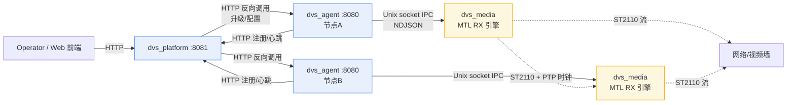

# 节点间通信与 DVS 应用间通信分析及设计合理性评估

> 仓库：`kkkqkx123/Media-Transport-Library`（`app/` 目录）
> 分析对象：控制面（`dvs_agent` ↔ `dvs_platform`）、节点内（`dvs_agent` ↔ `dvs_media`）、节点间媒体（`dvs_media` ↔ `dvs_media`）、平台编排（`OpCoordinator` / 布局拆分）
> 重点问题：**当前项目的节点间通信是怎样的？dvs 应用间的通信是怎样的？现有设计是否合理？**

---

## 0. 结论速览

| 问题 | 结论 |
|---|---|
| 节点间（跨主机）通信 | **星形/中心辐射拓扑**：所有跨节点控制流量都经由中心 `dvs_platform`（:8081）。节点 `dvs_agent`（:8080）向平台 **HTTP 注册/心跳**；平台向节点**反向 HTTP 调用**（升级、配置下发）。**节点与节点之间无直接应用层通信**。 |
| dvs 应用间（同主机）通信 | `dvs_agent` ↔ `dvs_media` 通过 **Unix 域套接字 IPC**（AF_UNIX、NDJSON 行协议）通信；`dvs_agent` ↔ `dvs_platform` 通过 **HTTP** 通信。 |
| dvs_media ↔ dvs_media | **无应用层通信**。各媒体引擎独立接收 ST2110 流、独立渲染本节点"屏幕墙"切片；跨节点同步完全依赖 **PTP 时间域 + ST2110 媒体时钟**（物理/时钟层），而非消息层。 |
| 设计合理性 | **架构方向正确**（控制/数据面分离、本地 IPC、星形平台、两阶段提交屏障、PTP 做媒体同步），但**实现完整性有缺口**：平台→节点的布局/配置 fan-out 与节点→平台 commit 回执在已读代码中未闭环，两阶段提交目前只是骨架；控制面 HTTP 为裸 socket HTTP/1.0、无鉴权/TLS；鉴权默认关闭。属于"原型级但架构清晰"，离生产级有差距。 |

---

## 1. 通信拓扑总览

三条通信链路：

1. **链路 A（跨节点控制上行）**：`dvs_agent` → `dvs_platform`，HTTP POST 注册/心跳（`registration.cpp:108-156`）。
2. **链路 B（跨节点控制下行）**：`dvs_platform` → `dvs_agent`，HTTP 反向调用（升级 `platform/main.cpp:342-373`；布局/配置下发目前**未完全闭环**，见 §4）。
3. **链路 C（同节点控制）**：`dvs_agent` ⇄ `dvs_media`，Unix socket IPC（`media_ipc.cpp` ⇄ `ipc_server.c`）。
4. **链路 D（跨节点媒体，无应用层）**：`dvs_media` ⇄ `dvs_media`，仅 ST2110 流 + PTP 时钟，无消息交互。

---

## 2. 节点间通信（跨主机）详解

### 2.1 上行：agent → platform（注册 / 心跳）

- **传输**：`dvs_common` 内自研 `HttpClient`（`http_client.cpp`，裸 `socket` + 手写 HTTP/1.0 请求，无 TLS、无 keep-alive、单次 `poll` 超时）。
- **注册**（`registration.cpp:108-138`）：POST `{platform_url}/api/v1/nodes/register`，带 `sn/mac/model/firmware/role/capability/network/ptp`；平台回 `nodeId` 与 `heartbeatIntervalMs`，agent 持久化到本地 SQLite（`NodeStore`）。
- **心跳**（`registration.cpp:140-156`，周期由平台下发，默认 3000ms）：POST `/api/v1/nodes/heartbeat`，上报 `uptimeSec`、`appliedRevision`、**媒体统计（rxSessions/decoding/layers）**、**PTP 状态**、`resources`（内存/温度）。注意：心跳里的媒体数据来自对本地 `dvs_media` 的 `query_state` IPC（`registration.cpp:212`）。
- **失联处理**：连续 3 次心跳失败标记 `online=false`（`registration.cpp:86-94`）。
- **本地自治模式**：`platform_url` 为空时跳过注册，仅本地自维护 liveness（`registration.cpp:56-70`），媒体输出不受传输故障影响——这是合理的健壮性设计。

### 2.2 下行：platform → agent（反向 HTTP）

- **升级 fan-out**（`platform/main.cpp:342-373`）：POST `/api/v1/nodes/upgrade` 携带 `targetNodeIds`；平台**逐节点串行**调用各 agent 的 `agentBase + /api/v1/node/upgrade`（成功/failed 隔离，不中断其余节点）。
- **墓碑防复活**（`platform/main.cpp:266-272`）：退役节点写墓碑（`tombstone_add`），注册时 `tombstone_check` 拒绝（410），防止重启后"复活"。
- **布局拆分**（`dvs_platform/layout.cpp`）：`layout_window_fragment` 把整墙窗口按各节点矩形**切出每节点像素级子布局**（可见切片回映射到源像素 `src->x/y/w/h`）。拆分结果需下发给各节点——**但已读代码中平台并未显式把子布局 HTTP 推给 agent**（见 §4 缺口）。

### 2.3 跨节点屏障（两阶段提交）

- `OpCoordinator`（`ops.cpp` / `ops.h`）：纯逻辑、无 socket。`begin(op, rev, members, apply_at_ns)` 起 prepare 屏障；`on_reply(op, node, ok, status)` 收集各节点就绪；`missing(op)` 查缺；`rollback_op` 在 blocked 时回退到 `revision-1`。
- 触发面（`platform/main.cpp:286-340`）：`POST /api/v1/ops/prepare`（带 `operationId/revision/fps/members`）→ `begin` 并算 `apply_at_ns = layout_apply_at_ns(now, fps)`（给 2 帧 + ≥50ms 守卫，`layout.cpp:44-49`）；`POST /api/v1/ops/commit`（带 `node/status`）→ `on_reply` 推进状态，全就绪转 `committed`，任一 blocked 则 `rollback`。
- 意图：让多节点在**同一未来 PTP 时刻**切换布局，实现"视频墙"帧级对齐切换。

---

## 3. dvs 应用间通信（同节点 + 媒体引擎之间）

### 3.1 同节点：agent ⇄ media（Unix socket IPC）

- **服务端** `dvs_media` 的 `ipc_server.c`：`socket(AF_UNIX, SOCK_STREAM)` + `bind/listen`，`DVS_IPC_MAX_CLIENTS=8`（`ipc_server.c:304-363`）。逐行读取 NDJSON 请求（`handle_line`）。
- **客户端** `dvs_agent` 的 `media_ipc.cpp`：`MediaIpcClient`，连接 `--media-sock` 指定路径，`request(type, payload, timeout_ms)` 写一行 JSON 并读取以 `requestId` 匹配的回执；**事件行（`media.*`）缓存到环形缓冲**（`media_ipc.cpp:122-134`），由 `/api/v1/node/media/events` 排出（`agent/main.cpp:475-477`）。
- **协议类型**（`ipc_server.c:182-293`）：`configure / set_sources / prepare / commit / abort / clear / query_state / event`。回执统一信封 `{"ok","status","code","msg","data","requestId"}`，与平台/agent 的 HTTP 信封同构。
- **异步 prepare**：`prepare` 收到后 `spawn_prepare` 起 detached 线程，先回 `202 ACCEPTED`，完成后发事件 `media.prepare.result`（`ipc_server.c:107-149, 117-122`）。
- **事件广播**：`broadcast_event` 把 `media.layout_applied` 等推给所有已连客户端（`ipc_server.c:66-76`）。
- **agent 转发配置到 media**（`agent/main.cpp:331-342`）：当 `input/output/role` 配置被改动，agent **best-effort** 转发 `set_sources`/`configure` 到 media IPC，**绝不让 IPC 失败阻塞配置落库**——这是合理的韧性取舍。

### 3.2 媒体引擎之间：dvs_media ⇄ dvs_media（无应用层通信）

- **事实**：`dvs_media` 源码中**没有任何节点间 socket / HTTP / RPC**。每个媒体引擎独立：接收属于自己的 ST2110 流（按 `sip:udp_port` 白名单准入，`engine_ctx.c:130-141` 的 `dvs_session_admit`）、解码、合成、DRM 输出本节点那块墙。
- **跨节点"同步"靠什么**：
  - **PTP 共享时间域**：各节点 `mtl_ptp_read_time` 锚定到同一 TAI（`engine_ctx.c:176`、`ipc_engine_bridge.c:36-42`）；
  - **ST2110 媒体时钟**：流的 `timestamp` 经 `media_clk_frame_pts` 锚定（`mtl_rx_mp4.c:79-80`）；
  - **apply_at_ns 屏障**：平台计算统一未来时刻，各节点在该时刻切换布局（`layout_apply_at_ns`）。
- **设计含义**：视频墙的逐帧对齐**刻意不依赖应用层消息**（应用层消息延迟抖动会破坏帧同步），而是把同步下沉到线缆/PTP/ST2110 时钟层。这对低时延视频墙是**正确且主流**的做法。

### 3.3 控制面 ↔ 控制面（agent ↔ platform，见 §2）

略，已在 §2 覆盖。补充：`dvs_common` 的 `HttpClient`/`HttpServer` 同时服务 agent 与 platform，两端**自包含 in-tree 编入**各自二进制，无共享动态库依赖。

---

## 4. 现有设计合理性评估

### 4.1 合理 / 优点

| 项 | 说明 |
|---|---|
| 控制/数据面彻底分离 | 控制面（agent/platform/common）纯 HTTP + SQLite，零 MTL 依赖；数据面（dvs_media）独占 MTL。故障域隔离好。 |
| 同节点用 Unix socket IPC | 比 TCP 本地环回更安全（文件权限即可控）、更低开销、无网络暴露 media 引擎。 |
| 星形平台拓扑 | 节点只认中心平台，注册/心跳/网关/升级/墓碑集中管理，运维简单，天然支持"本地自治"降级。 |
| 两阶段提交屏障（意图） | `prepare` 收集就绪 + `commit` 统一切换 + `apply_at_ns` 对齐 PTP 时刻，是视频墙一致性切换的标准范式。 |
| 媒体同步下沉到 PTP/ST2110 | 不依赖应用层消息做帧同步，符合低时延视频墙工程常识。 |
| 配置转发 best-effort | agent 把配置转发 media 失败不阻塞落库，传输抖动不致丢配置（可从 `/node/media/status` 观测）。 |
| 串行隔离升级 | 逐节点升级、失败隔离，避免"一损俱损"。 |

### 4.2 风险 / 缺口（按严重度）

| 严重度 | 项 | 证据 | 影响 |
|---|---|---|---|
| **高** | 两阶段提交未闭环 | 平台 `/api/v1/ops/commit` 靠 `on_reply(op, node, ...)` 收集节点回执（`platform/main.cpp:315-340`），但 `dvs_agent` 代码中**没有任何地方调用**该接口；平台也**未把 per-node 子布局 fan-out 给 agent**（`layout.cpp` 只算不推）。 | 跨节点"同步切换"目前是**骨架**，端到端不可达；屏障状态机仅靠外部手动喂 `node/status`。 |
| **高** | 配置权威源分裂 | 平台存 groups/walls/scenes/bindings 文档（`platform/main.cpp:378-381`）；agent 自己也有 `/api/v1/node/config/<scope>` 与本地 `NodeStore`（`agent/main.cpp:280-361`）。两者**无可见同步路径**（平台不推配置给 agent）。 | 存在双份真相、配置漂移风险；"谁改了墙"难以溯源。 |
| **中** | 控制面 HTTP 为裸 socket HTTP/1.0 | `http_client.cpp` 手写请求、无 TLS、无 keep-alive、单次 `poll` 超时、无重试/连接池；`HttpServer` 同步阻塞处理文件与 IPC。 | 仅适合受信任 LAN；并发/可靠性不足；`media_ipc.request()` 在 HTTP handler 内阻塞等待 media（最长 `timeout_ms`），并发请求会串行化。 |
| **中** | 鉴权默认关闭 | `agent/main.cpp:252` `g_require_auth = (getenv("DVS_REQUIRE_AUTH") != nullptr)`，默认 off；session 硬编码 `sess-1`（`agent/main.cpp:212`）。 | 原型可接受，生产需强制鉴权 + 节点间 mTLS。 |
| **中** | 节点间无应用层心跳/就绪回执进屏障 | 屏障只认 `node` 级 ready，但**每个 ST2110 通道的 MTL RX 就绪**未回灌；PTP 漂移/某路流中断平台侧不可见。 | 屏障"全就绪"可能掩盖个别 lane 实际未就绪。 |
| **低** | IPC 事件广播给所有 client | `broadcast_event` 推给全部 8 个 slot（`ipc_server.c:66-76`），多 client 时可能收到非己方事件（目前通常仅 agent 连接，影响小）。 |
| **低** | IPC 池/槽为 O(N) 扫描 | `rx_pool_acquire`、client 槽查找为线性扫描（`ipc_server.c:342-347`、`mtl_rx.c:36-43`），N≤16/8 无碍，规模化需换结构。 |

### 4.3 综合判断

- **架构层面：合理且清晰。** 控制/数据面分离、本地 IPC、星形平台、PTP/ST2110 做媒体同步、两阶段提交做一致性切换——这套选型与低时延视频墙/分布式媒体系统的工程惯例一致，方向正确。
- **实现层面：原型级、关键链路未闭环。** 最关键的"平台拆墙 → 逐节点下发子布局 → 节点 prepare → 回执 commit → 统一时刻切换"链路在已读代码中**只有前半段（拆墙）和后半段（屏障状态机）独立存在，中间 fan-out 与回执未接线**。此外控制面 HTTP 缺 TLS/鉴权、配置双真相源未打通。
- **建议优先级**：
  1. 打通 **平台→agent 子布局下发**（`/api/v1/node/config` 或新增 `/media/layout`）与 **agent→平台 commit 回执**（`/api/v1/ops/commit`），让两阶段提交真正可运行；
  2. 明确 **配置唯一权威源**（建议平台为 source of truth，agent 只缓存/执行），用广播+监听者或增量推送消除漂移；
  3. 控制面加 **mTLS + 强制鉴权 + 连接复用**，至少在内网边界启用；
  4. 把 **每 lane MTL RX 就绪/丢帧指标**回灌屏障，使"全就绪"具备真实语义；
  5. IPC 池/槽在节点规模扩大前无需改，但建议预留哈希/红黑树。

---

## 5. 关键代码索引

| 主题 | 文件:行 |
|---|---|
| agent→platform 注册 | `dvs_agent/registration.cpp:108-138` |
| agent→platform 心跳（含 media query_state） | `dvs_agent/registration.cpp:140-156, 212` |
| platform 接收注册/心跳 | `dvs_platform/main.cpp:170-218` |
| 平台升级 fan-out | `dvs_platform/main.cpp:342-373` |
| 两阶段提交屏障（prepare/commit） | `dvs_platform/main.cpp:286-340`、`dvs_platform/ops.cpp` |
| 布局像素拆分 | `dvs_platform/layout.cpp:13-49` |
| agent→media IPC 客户端 | `dvs_agent/media_ipc.cpp:69-165` |
| media IPC 服务端 | `dvs_media/ipc/ipc_server.c:304-409` |
| agent 转发配置到 media | `dvs_agent/main.cpp:331-342` |
| dvs_media MTL 初始化 | `dvs_media/engine/engine_ctx.c:106-121, 195-204` |
| dvs_media 复用 file_playout RX | `dvs_media/meson.build:46-94` |
| 裸 socket HTTP 客户端 | `dvs_common/src/http_client.cpp:30-117` |
| 鉴权默认关闭 | `dvs_agent/main.cpp:252` |
