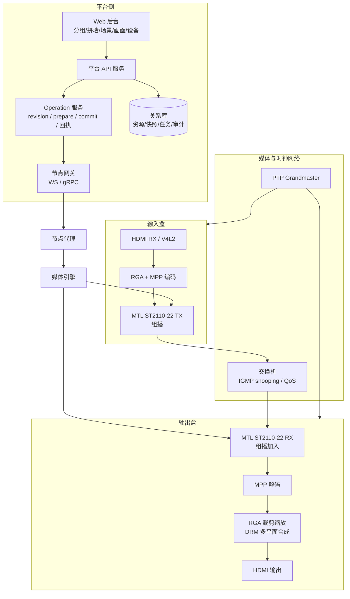
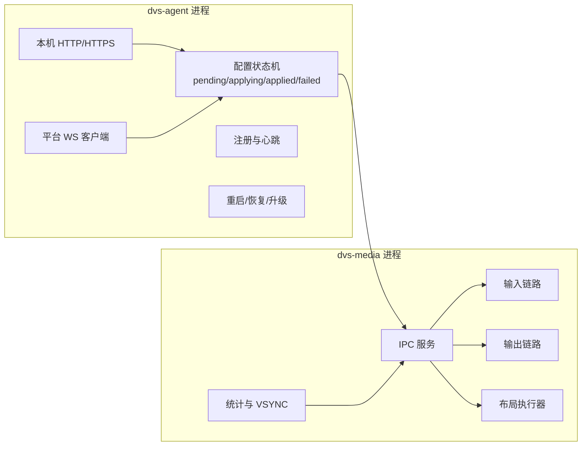

# 端到端技术方案

本文给出 DVS 在 MTL 基座上的目标架构、媒体链路、控制链路、同帧机制和关键取舍。所有参数为 V1.0 候选值，需硬件与联调实测确认。

## 1. 总体架构



职责划分：

| 层 | 组件 | 职责 |
| --- | --- | --- |
| 平台 | Web、API、Operation、DB | 业务模型、快照、权限、状态机、审计 |
| 网关 | 节点网关 | 长连接、下发、回执、心跳 |
| 节点 | 节点代理 | 注册、配置、本机页、升级、状态上报 |
| 节点 | 媒体引擎 | 采集、编解码、组播收发、合成、音频 |
| 基座 | MTL | ST2110 收发、PTP、组播、pacing、冗余 |

## 2. 部署拓扑

```text
                 ┌─────────────────────┐
                 │ 平台服务器           │
                 │ API / DB / 网关      │
                 │ PTP Grandmaster(可选)│
                 └─────────┬───────────┘
                           │ 控制网络
        ┌──────────────────┼──────────────────┐
        │                  │                  │
   输入盒 x N          输出盒 x M          维护终端
        │                  │
        └────── 媒体网络（组播）──────────────┘
```

建议物理或 VLAN 分离：

- 控制网络：平台 API、节点注册、心跳、媒体控制。延迟不敏感，要求可靠。
- 媒体网络：ST2110 组播、PTP。要求低抖动、IGMP snooping、QoS。
- 管理网络：节点本机页、SSH、固件上传。限制来源。

小规模部署可以合并控制与媒体网络，但需要 QoS 保证媒体流优先。

## 3. 节点软件架构



进程隔离的理由：

- 节点代理崩溃或升级时，媒体引擎继续出画。
- 媒体引擎崩溃时，代理可以拉起并恢复最后布局。
- 控制面与数据面线程分离，避免控制请求破坏 pacing。

IPC 建议使用 Unix domain socket + protobuf 或 JSON。消息类型：

```text
configure(role, input, output, network)
prepare(operation_id, wall_id, revision, layout_fragment, sources)
commit(operation_id, revision, apply_at_tai_ns)
abort(operation_id)
set_sources(wall_id, sources)
clear(wall_id, keep_base_image)
query_state()
event(state, revision, stats, vsync)
```

## 4. 媒体链路

### 4.1 输入盒

```text
HDMI RX
  -> V4L2 采集（DMA-BUF）
  -> RGA 色彩转换/缩放
  -> MPP H.264/HEVC 编码（低延迟、无 B 帧、CBR）
  -> MTL ST2110-22 TX（组播）
  -> 音频：ALSA 采集 -> ST2110-30 TX
```

关键点：

- V4L2 采集使用 DMA-BUF 导出，MPP 直接消费，减少拷贝。
- 编码参数：GOP 0.5–1 秒、无 B 帧、CBR、低延迟模式。
- 每路采集口一个 ST22 会话和一个组播地址。
- 时间戳：采集时刻打 PTS，编码后通过 SEI 或 ST22 时间戳传递，供输出端同步。

### 4.2 输出盒

```text
组播加入
  -> MTL ST2110-22 RX
  -> 码流重组
  -> MPP 解码
  -> 帧缓冲（按 PTS 排序）
  -> RGA 裁剪/缩放
  -> DRM plane 合成
  -> HDMI 输出
```

关键点：

- 每个需要的信号一个 RX 会话和一个解码器。
- 解码输出进入播放缓冲，按 PTS 和 PTP 时钟对齐。
- 每个窗口一个 DRM plane；plane 的源裁剪矩形对应全局窗口中的本节点片段。
- 超过硬件 plane 数时，用 GPU/RGA 先合成到中间 framebuffer。
- 输出帧率固定（例如 60 Hz），源帧率不同时做重复/丢帧。

### 4.3 音频

```text
ST2110-30 RX -> 抖动缓冲 -> 音量增益 -> ALSA -> HDMI 音频
```

- 只有获得音频归属的窗口把音频送到 ALSA。
- 场景音量 0–100 映射为线性或对数增益。
- 窗口静音在节点侧执行，平台状态作为期望值。
- 多路音频竞争时，节点按平台下发的 `audio_owner_window_id` 选择，缺省选最新窗口。

## 5. 全局坐标与跨格拆分

### 5.1 坐标系

建墙时固化格位矩阵：

```text
cell[r][c] = {x, y, w, h}   单位：整墙像素
wall = {width: sum(w), height: sum(h)}
```

标准 LCD 通常每格等分；LED 可能逐行逐列不同。窗口、底图、绑定都使用整墙像素坐标。

### 5.2 节点片段

节点 N 绑定格位集合 `C(N)`。节点本地画布原点取 `C(N)` 的包围盒左上角。

```text
for each cell in C(N):
    inter = intersect(window, cell)
    if inter.empty: continue
    dst = inter - nodeOrigin
    src = map(inter, window, sourceSize)
    emit plane(dst, src, z)
```

`map` 使用窗口内相对位置：

```text
src.x = (inter.x - window.x) * source.w / window.w
src.y = (inter.y - window.y) * source.h / window.h
src.w = inter.w * source.w / window.w
src.h = inter.h * source.h / window.h
```

### 5.3 边界规则

- 相邻格位共享边界，使用半开区间 `[x, x+w)`。
- 左/上取整向下，右/下取整向上，避免缝隙。
- 源裁剪坐标限制在 `[0, source.w]` 和 `[0, source.h]`。
- 所有节点使用同一套整数函数，版本化在平台侧，节点不自行取整。
- 显示设备 overscan 校准值单独保存，不混入业务坐标。

### 5.4 节点画布与输出分辨率

节点本地画布尺寸等于其格位包围盒。输出分辨率与画布尺寸不一致时，由 RGA 统一缩放到输出模式。建议节点输出模式尽量等于画布尺寸，减少一次缩放。

### 5.5 多格位节点

一台输出盒可以绑定同一面墙的多个格位。节点本地画布覆盖这些格位的包围盒，未被绑定格位对应的区域保持黑色或底图。节点级绑定约束仍然有效：一台盒只属于一面墙。

## 6. 同帧机制

### 6.1 时间基准

- 全网一个 PTP 域，Grandmaster 可以是平台服务器、核心交换机或专用时钟。
- 节点使用 linuxptp，媒体引擎读取 `CLOCK_TAI`。
- 定义会话帧纪元 `epoch_tai_ns` 和输出帧率 `fps`。
- 全局帧号 `frame(t) = floor((t - epoch) * fps)`。

所有节点使用同一 `epoch` 和 `fps`，才能把 `apply_at` 映射到同一个帧号。

### 6.2 prepare

平台在创建 operation 后下发 prepare：

```json
{
  "operationId": "op_01H...",
  "wallId": "wall_1",
  "revision": 42,
  "sources": [
    {"signalId": "in01-hdmi1", "mcast": "239.10.1.1", "port": 20000,
     "codec": "h264", "width": 1920, "height": 1080, "fps": 60}
  ],
  "layout": {
    "canvas": {"w": 3840, "h": 2160},
    "planes": [
      {"windowId": "w1", "signalId": "in01-hdmi1",
       "dst": {"x": 0, "y": 0, "w": 1920, "h": 1080},
       "src": {"x": 0, "y": 0, "w": 1920, "h": 1080},
       "z": 10, "visible": true}
    ],
    "audioOwner": "w1",
    "volume": 80,
    "baseImage": {"revision": 7, "url": "..."}
  }
}
```

节点执行：

1. 校验 revision 和 operation 未过期。
2. 对缺失的信号加入组播，创建 RX 会话和解码器。
3. 等待每个信号至少解出一帧。
4. 预分配 DRM plane 和 framebuffer，设置属性但保持当前画面。
5. 计算本地片段，写入影子布局。
6. 返回 ready，附带时钟状态和解码状态。

### 6.3 commit

全部节点 ready 后，平台计算：

```text
apply_at = now + guard
guard = max(2 / fps, 50 ms)
```

下发 commit：

```json
{"operationId": "op_01H...", "revision": 42, "applyAtTaiNs": 1700000000123000000}
```

节点执行：

1. 把 `apply_at` 映射到目标帧号 N。
2. 在帧 N-1 的 VSYNC 或 vblank 上执行原子提交。
3. 新布局在帧 N 生效。
4. 回执 `applied(revision, frame=N, actualTaiNs)`。

### 6.4 全有或全无

- commit 前有 ready 屏障，任一节点未 ready 则不下发 commit。
- commit 后节点保留旧布局的影子副本。
- 若任一节点在帧 N 未完成提交，平台标记 operation 失败，并向所有参与节点下发 rollback 到 revision-1。
- 平台只有在全部 applied 后才更新“当前场景”。

影子副本和 rollback 是满足“整墙不出现混合场景”的关键。V1.0 需要把提交路径控制在“切 plane 属性”，避免解码器重建导致不可预测延迟。

### 6.5 时钟资格

| 条件 | 阈值 | 处理 |
| --- | --- | --- |
| PTP 状态 | synced | 否则 blocked |
| 时钟偏差 | ≤ 2 ms | 否则 blocked |
| 帧号一致性 | 同一 epoch/fps | 否则 blocked |
| 解码就绪 | 每个信号至少一帧 | 否则 blocked |
| 节点在线 | 心跳正常 | 否则 blocked |

阈值需实测调整。60 Hz 下 2 ms 约占一帧的 12%，留有提交余量。

## 7. 场景切换与源切换

### 7.1 场景切换

场景切换只改变布局和可见性，已订阅的信号继续接收。这样提交路径短、可预测。

如果新场景引用了未订阅的信号，prepare 阶段需要加入组播并等待关键帧。关键帧等待时间取决于 GOP：

| GOP | 最坏等待 | 适用 |
| --- | --- | --- |
| 0.5 s | 0.5 s | 推荐，满足 NFR-03 |
| 1 s | 1 s | 边界 |
| 2 s+ | 超过 1 s | 不推荐 |

### 7.2 源切换

窗口换源时，若新源已订阅，直接切换 plane 的 framebuffer 来源，在帧边界生效。

若新源未订阅：

1. 加入组播，创建解码器。
2. 等待关键帧和首帧解码。
3. 在下一个帧边界替换 plane。
4. 旧解码器按引用计数延迟释放，避免影响其它窗口。

MTL 的 `st22p_rx_update_source` 可以在不重建会话的情况下换源，适合同编码参数的快速切换。

### 7.3 常驻订阅策略

为降低切换等待，输出节点可以常驻订阅该墙白名单内的全部信号。代价：

- 每个信号一个解码器，受 `maxDecodeSessions` 限制。
- 网络带宽按信号数累加。
- CPU/MPP 负载增加。

建议 V1.0 采用“白名单内常驻 + 上限保护”：

- 每个输出节点最多常驻 8 路 1080p60 解码。
- 超过上限时按当前场景和最近使用排序，淘汰冷门信号。
- 淘汰后再次使用需要重新等待关键帧，页面提示“正在准备信号”。

## 8. 编码与带宽

### 8.1 方案对比

| 方案 | 带宽/路 | 时延 | 切换 | 硬件 | 适用 |
| --- | --- | --- | --- | --- | --- |
| ST2110-20 未压缩 1080p60 | ~2.7 Gbps | 最低 | 无 GOP | 10GbE | 高端有线场景 |
| ST2110-20 未压缩 4K60 | ~11 Gbps | 最低 | 无 GOP | 25/40GbE | 特殊场景 |
| ST2110-22 H.264 1080p60 | 10–40 Mbps | 中 | 受 GOP 影响 | 1GbE + MPP | V1.0 默认 |
| ST2110-22 HEVC 4K60 | 40–120 Mbps | 中 | 受 GOP 影响 | 1GbE+ + MPP | 4K 场景 |
| ST2110-22 JPEG XS | 100–500 Mbps | 低 | 帧内 | 需编解码支持 | 有硬件时优选 |

RK3588 具备 MPP H.264/HEVC 硬件编解码，千兆口下推荐 H.264/HEVC 压缩方案。

### 8.2 带宽核算

单输出节点接收的信号数 `S`，平均码率 `B`：

```text
node_bandwidth ≈ S × B × 1.1
```

示例：

| 场景 | S | B | 估算 |
| --- | --- | --- | --- |
| 1080p60 标清质量 | 8 | 20 Mbps | 176 Mbps |
| 1080p60 高质量 | 8 | 40 Mbps | 352 Mbps |
| 4K60 高质量 | 4 | 80 Mbps | 352 Mbps |

千兆口可承载，但需要交换机 IGMP snooping 和 QoS。输入盒出口带宽为 `路数 × B`，通常远低于千兆。

### 8.3 组播规划

- 每个输入采集口一个组播组。
- 同一信号被多墙引用时复用组播组。
- 使用 SSM（指定源组播），RX 配置 `mcast_sip_addr` 过滤源。
- 交换机开启 IGMP snooping，避免组播泛洪。
- 组播 TTL 限制在媒体 VLAN。
- 平台维护地址池并校验冲突。

## 9. 时延预算

| 环节 | 典型值 | 说明 |
| --- | --- | --- |
| 采集 | 16–33 ms | 一帧缓冲 |
| 编码 | 10–30 ms | MPP 低延迟 |
| 网络 | 1–5 ms | 局域网 |
| 抖动缓冲 | 20–50 ms | 可调 |
| 解码 | 10–30 ms | MPP |
| 合成 | 5–10 ms | RGA + DRM |
| 显示 | 8–16 ms | 60 Hz |
| 合计 | 70–170 ms | 端到端 |

对照 NFR：

| 指标 | 目标 | 可行性 |
| --- | --- | --- |
| NFR-02 单窗口拖动更新 P95 ≤ 500 ms | 500 ms | 可行，布局切换不重建解码器 |
| NFR-03 场景切换 P95 ≤ 1 s | 1 s | 可行，前提是信号已订阅且 ready |
| NFR-04 同帧偏差 ≤ 1 帧 | 16.7 ms @60Hz | 需要 PTP 与提交路径实测 |
| NFR-05 离线识别 ≤ 10 s | 10 s | 3 秒心跳 × 3 次 = 9 秒 |
| NFR-06 恢复同步 ≤ 30 s | 30 s | 依赖重连和会话恢复 |
| NFR-07 断网保画 | 30 分钟 | 媒体引擎独立，保持最后帧 |

## 10. 离线保画与恢复

### 10.1 控制链路断开

- 节点代理检测到 WS 断开，不向媒体引擎发送清屏或停止命令。
- 媒体引擎继续接收组播、解码、显示最后布局。
- 节点代理按退避重连，重连后上报 applied revision 和媒体状态。

### 10.2 媒体流中断

- RX 会话超时，解码器保留最后一帧。
- DRM plane 继续扫描最后一个 framebuffer。
- 页面显示“信号源已离线”，不自动关窗。
- 流恢复后从最近关键帧继续解码。

### 10.3 节点重启

- 媒体引擎从本地持久化文件恢复最后布局和信号列表。
- 若平台可达，先拉取最新 desired revision；若不可达，按最后布局出画。
- 恢复后上报 applied revision，平台决定是否补发。

### 10.4 平台重启

- 平台从数据库和节点上报重建状态。
- 节点媒体流不中断。
- 未完成 operation 标记 expired 或 failed，不自动重放。

## 11. 底图与图像调节

### 11.1 底图

- 平台按节点格位并集裁剪底图，生成子图。
- 节点把子图解码为 framebuffer，放在最底层 plane。
- 窗口 plane 在底图之上。
- 清屏后只保留底图 plane。
- 底图更新在下一个场景切换或清屏时生效，避免运行中突变。

### 11.2 图像调节

亮度、对比度、饱和度、色调整墙统一。可选实现：

1. DRM plane 的 `brightness`、`contrast`、`saturation`、`hue` 属性（若驱动支持）。
2. RGA 色彩空间转换和增益。
3. GPU 着色器后处理。

V1.0 建议先做驱动属性探测，能力不支持时降级为 RGA/GPU 路径。平台只下发目标值，节点上报实际应用能力。

## 12. 设备能力与注册

节点注册请求携带能力：

```json
{
  "sn": "RK3588-0001",
  "mac": "02:00:00:00:00:01",
  "role": "output",
  "firmware": "1.0.0",
  "mtl": {"version": "26.09", "backend": "native_af_xdp"},
  "ptp": {"supported": true, "hwTimestamp": false},
  "inputPorts": [],
  "outputPorts": [{"id": "hdmi0", "maxWidth": 7680, "maxHeight": 4320,
                   "maxRefresh": 60, "presets": ["1080p60", "2160p60"]}],
  "codecs": {"decode": ["h264", "hevc"], "encode": ["h264", "hevc"]},
  "maxDecodeSessions": 8,
  "maxLayers": 8,
  "memory": {"totalMb": 8192, "hugepages": 2048}
}
```

平台把这些值写入 `dvs_capability` 快照，用于绑定、开窗、输出参数校验。

## 13. 容量规划

| 维度 | 候选基线 | 约束点 |
| --- | --- | --- |
| 节点总数 | 128 | 平台连接数、心跳、注册 |
| 拼墙数 | 64 | 平台资源 |
| 单墙窗口 | 64 | 平台布局计算、节点图层 |
| 单节点解码 | 8 路 1080p60 | MPP 能力、内存 |
| 单节点图层 | 8 | DRM plane；超出用 GPU 合成 |
| 单墙输出节点 | 64 | 同帧回执聚合 |
| 单输入盒采集 | 1 路 | 产品 Q-39 单采集口 |
| 组播流数 | 按输入口总数 | 交换机组播容量 |

平台侧建议用节点模拟器压测 128 节点注册、心跳和 operation 聚合。媒体侧建议用 4 台 RK3588 做 2×2 墙，逐步扩到 4×4。

## 14. 安全设计

- 平台与节点之间使用 TLS，节点证书由平台签发或预置。
- 节点本机页使用 HTTPS，密码哈希存储（Argon2 或 bcrypt），登录限速。
- 固件包签名，节点校验签名和 SHA-256 后才写入。
- 媒体网络与控制网络隔离，限制组播源。
- 节点不暴露 shell；升级和运维只通过受限接口。
- 审计记录所有结构变更、绑定、场景切换、设备退役和升级。

## 15. 关键取舍

| 取舍 | 选择 | 理由 |
| --- | --- | --- |
| 合成位置 | 输出节点本地合成 | 同帧控制简单，带宽按信号而非按格位增长 |
| 编码方式 | V1.0 默认压缩 | 千兆网络可落地；万兆可选未压缩 |
| 跨格实现 | 全局坐标拆分到节点片段 | 复用 DRM 多平面，避免源端多路编码 |
| 同帧时基 | PTP + 全局帧号 | 与 ST2110 体系一致，MTL 原生支持 |
| 控制通道 | WS/gRPC + 节点代理 | 与媒体进程解耦，便于恢复 |
| 节点配置真源 | 节点本机页 | 符合 REQ-0008/0009 的单机边界 |

## 16. 备选方案

### 16.1 源端拆块

输入盒按输出节点把画面拆成多路编码，每个节点收自己那一块。

优点：节点解码和合成简单，带宽按块分配。
缺点：源端编码路数随墙规模增长；跨节点窗口切换需要同时增删多路流；同帧协调更复杂。

V1.0 不采用。

### 16.2 全未压缩

所有信号以 ST2110-20 未压缩传输，输出节点直接合成。

优点：无编码时延，无 GOP，同帧最容易。
缺点：带宽高，需要万兆或更高；RK3588 网口通常不满足。

作为高端可选配置保留。

### 16.3 中心合成

平台侧或专用合成服务器统一合成，再把整墙画面编码分发。

优点：节点只做显示。
缺点：中心服务器成为单点和带宽瓶颈；跨墙扩展差。

V1.0 不采用。
